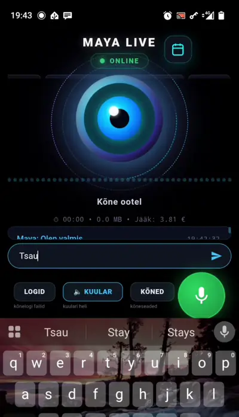

<h1 align="center">MAYA</h1>

<p align="center">
  <strong>Maya helistab sulle. Mitte vastupidi.</strong>
</p>

<p align="center">
  Eestikeelne tehisintellekti kaaslane, kes räägib sinuga loomulikult,<br>
  peab meeles sinu tegemisi ja tuletab olulisi asju meelde.
</p>

<p align="center">
  <strong>🇪🇪 Eesti keeles (see fail)</strong> ·
  <a href="README_EN.md">🇬🇧 In English</a> ·
  <a href="docs/PAIGALDAMINE.md">📦 Paigaldusjuhend</a> ·
  <a href="docs/README.md">📚 Dokumentatsioon</a>
</p>

<p align="center">
  <a href="LICENSE"></a>
  
  
  
  
</p>

<p align="center">
  <strong>🚀 <a href="docs/PAIGALDAMINE.md">ALUSTA SIIT: paigaldusjuhend</a></strong><br>
  <sub>või jooksuta <code>./paigalda.sh</code> — skript juhendab sind samm-sammult</sub>
</p>

---

## Maya päriselt töös – OnePlus 6

<p align="center">
  
</p>

<p align="center">
  <sub><strong>Mängib siinsamas</strong> — 24-sekundiline katkend, kordub, <strong>helita</strong>.<br>
  Täispikk salvestus koos heliga (2 min 35 s, 17 MB):
  <a href="https://github.com/banaaniwabariik-rgb/maya-voice-assistant/blob/main/docs/media/maya-oneplus6.mp4">maya-oneplus6.mp4</a></sub>
</p>

See on **päris ekraanisalvestus** MAYA-st töötamas **OnePlus 6
Android-telefonis** — mitte makett ega järeltöödeldud demo, vaid
telefoni ekraan nii, nagu see on. Näha on päris liides: hääle
visualiseerija, karakteri vahetamine, reaalajas transkript ja
kõnejuhtimine.

---

## Mis vahe on MAYA-l ja tavalisel AI-vestlusrobotil?

Tavaline vestlusrobot **ootab, et sina alustaksid**. Sa avad äpi,
kirjutad küsimuse, saad vastuse, sulged äpi. Vestlus lõpeb seal, kus
sina lahkud.

MAYA töötab teistpidi:

| | Tavaline AI-vestlusrobot | **MAYA** |
|---|---|---|
| Kes alustab | alati sina | **MAYA võtab ise ühendust** ja saadab telefonile kõnekutse |
| Suhtlusviis | kirjutad ja loed | **räägid** — loomuliku kõne rütmis, katkestamine lubatud |
| Vaikus vestluses | robot ootab lõputult | **MAYA võtab vaikuse järel ise sõna** |
| Kui jutt katkeb | lause jääb pooleli | **jätkab ise samast kohast** |
| Mäletamine | unustab vestluse lõppedes | **pikaajaline mälu** eesti keele käänetega otsinguga |
| Iseloom | üks üldine assistent | **10 erineva iseloomu ja häälega karakterit** |
| Keel | eesti keel on järelmõte | **eesti keel on lähtepunkt** — karakterid, viibad, liides, logid |
| Kelle masinas | kellegi teise pilves | **sinu enda serveris, sinu enda API võtmega** |

**MAYA ei ole veel üks ChatGPT-i ümbris.** Ta on eestikeelne
häälkaaslane, kes elab sinu enda masinas ja võtab vestluses ise
initsiatiivi.

---

## 📞 MAYA helistab sulle ise

See on projekti süda, nii et siin on **täpselt**, kuidas see töötab —
ilma ilustamata.

```
  SINU SERVER                                      SINU TELEFON
  ───────────                                      ────────────
  midagi juhtub                                    MAYA rakendus on
  (meeldetuletus / taimer /                        taustal, hoiab lahti
   MAYA enda otsus)                                SSE-ühendust
        │                                                │
        ├── sündmus → /api/call_events (SSE) ───────────►│
        │                                                │
        │                                    CallWatcherService
        │                                    (esiplaanateenus + wake lock)
        │                                                │
        │                                                ▼
        │                                    IncomingCallActivity
        │                                    • süsteemi helin + vibratsioon
        │                                    • ekraan ärkab, lukustuskuva peal
        │                                    • „vasta" / „keeldu"
        │                                                │
        └──────── vastad → Gemini Live seanss avaneb ────┘
                  MAYA alustab vestlust ESIMESENA
```

> ### ⚠️ Mis see EI ole
> **See ei ole tavaline mobiilikõne.** MAYA ei helista läbi
> telefonivõrgu, ei kasuta sinu numbrit ega SIM-kaarti ja kõne ei
> paista kõnelogis. Tegemist on **sinu enda serverist tuleva
> tõuketeatega**, mille peale rakendus avab telefonis kõneekraani, mis
> näeb välja ja käitub nagu sissetulev kõne: heliseb, vibreerib ja
> ilmub lukustuskuva peale. Kõne sisu liigub interneti kaudu sinu
> serverisse, mitte mobiilioperaatori võrku.

**Mis selle käivitab:**

| Käivitaja | Olek |
|---|---|
| `POST /api/trigger_call` — käsitsi või skriptiga | ✅ **otsast lõpuni kontrollitud** (sündmus jõudis SSE-voogu, server logis seadme ühenduse) |
| MAYA enda otsus vestluse ajal (`schedule_call` tööriist — „helista mulle 5 minuti pärast") | ⚙️ implementeeritud, mälus olev taimer (serveri taaskäivitus kustutab) |
| Ajastatud meeldetuletus (sh korduv) | ✅ **otsast lõpuni kontrollitud** — kaks kasutajat, meeldetuletus samal ajal: kumbki sai AINULT oma kõneteate (päris server, päris autentimine, päris SSE) |
| Kõne jõudmine **kõigisse** sama konto seadmetesse | ✅ fan-out, kaetud 6 testiga |
| Androidi pool (helin, lukustuskuva, vastamine) | ⚙️ implementeeritud, **päris seadmes kontrollimata** |

---

## Mida MAYA oskab

Iga rida on koodis üle kontrollitud. Olekud: ✅ testitud ·
⚙️ implementeeritud, aga mitte täielikult kontrollitud ·
🧪 osaline / katseline · ⚠️ katki või puudu.

### Hääl ja vestlus

| | Olek | Mis täpselt |
|---|---|---|
| **Eestikeelne häälvestlus** | ⚙️ | Gemini Live natiivheli (`gemini-2.5-flash-native-audio-preview-12-2025`), ainult heliväljund. Eesti keel tuleb eestikeelsetest karakteriviipadest — **Gemini Live ise on mitmekeelne mudel, mitte eestikeelne mudel** |
| **Katkestamine** | ✅ | sinu kõne katkestab MAYA kohe — VAD-i `START_OF_ACTIVITY_INTERRUPTS`, kaetud vestluse elutsükli testidega |
| **Omaalgatus vaikuse järel** | ✅ | karakteripõhine paus, seejärel võtab MAYA ise sõna |
| **Automaatne taaste** | ✅ | kui lause jääb pooleli, jätkab samast kohast ilma, et peaksid küsima |
| **Kasutaja prioriteet** | ✅ | sinu kõne katkestab omaalgatuse, taaste ja pooleliolevad päringud |
| **Hääletööriistad vestluse ajal** | ⚙️ | 10 tööriista: `add_reminder`, `get_reminders`, `schedule_call`, `recall_memory`, `set_user_name`, `get_weather`, `get_electricity_price`, `get_email_status`, `get_song_lyrics`, `get_last_turn_state` |

> **Oluline täpsustus:** vestluse elutsükli testid (voorud, katkestused,
> taaste, tühistamine — sadu teste) kasutavad **jäljendatud** Gemini
> seanssi ja kella. Need tõestavad MAYA enda loogikat, **mitte** Gemini
> Live'i käitumist. Päris Gemini teste komplektis ei ole, sest need
> nõuaksid võtit ja maksaksid raha.

### Karakterid ja mälu

| | Olek | Mis täpselt |
|---|---|---|
| **10 karakterit** | ✅ | `asjalik`, `sõber`, `sarkastiline`, `romantiline`, `filosoof`, `mentor`, `treener`, `zen`, `laulja`, `kohandatud` — igaühel oma Gemini hääl (Kore / Aoede / Leda / Zephyr) ja oma algatustase |
| **Kohandatud karakter** | ✅ | kirjutad ise juhise; testid tõestavad, et see **ei leki** ühegi teise karakteri viipasse |
| **Pikaajaline mälu** | ✅ | FTS5-otsing, eesti keele morfoloogia (käänded), faktide eraldamine vestlusest |
| **Mälu elutsükkel** | ✅ | duplikaadi tuvastus, vana fakti asendamine (`supersede`), vastuolu tuvastus, kindlusastmed — 18 testi |
| **Mälu eraldatus karakterite vahel** | ✅ | privaatne / karakteripõhine / ühine ulatus — 58 + 49 testi |

### Meeldetuletused ja kalender

| | Olek | Mis täpselt |
|---|---|---|
| **Meeldetuletuste CRUD** | ⚙️ | `GET/POST/DELETE/PUT /api/reminders`, autenditud. Loomine kontrollitud päringuga |
| **Loomine häälega** | ⚙️ | ütled vestluses ja MAYA salvestab ise (`add_reminder`) |
| **Kordused** | ⚙️ | `none`, `daily`, `weekly`, `workdays` |
| **Karakteripõhine esitus** | ⚙️ | meeldetuletuse loonud karakter esitab selle ka ette (nt lauljana loodud riimuv äratus) |
| **Hommikubriifing** | ⚙️ | `notify_type=briefing` kogub andmed **helistamise hetkel**, mitte salvestamise ajal |
| **Kalendrivaade** | 🧪 | kuu- ja nimekirjavaade (`calendar_module.js`), päevade kaupa, muuda/kustuta. **Eraldi kalendritabelit ei ole** — kalender on vaade meeldetuletuste peal |
| **Ajastatud meeldetuletuse kõne** | ✅ | taustavalvur käib läbi kõik kasutajabaasid, seab iga kasutaja konteksti ja saadab kõneteate ÕIGELE kasutajale — 25 testi + päris serveri kontroll |

### Android ja muu

| | Olek | Mis täpselt |
|---|---|---|
| **Androidi rakendus** | ⚙️ | WebView + natiivne helitorustik, kõneekraan, esiplaanateenus, lähedusandur, Bluetooth/kõlari vahetus |
| **Serveri aadress rakenduses** | ✅ | kasutaja sisestab ise, ühenduse test, 29 Kotlini testi puhtale loogikale |
| **Mitu seadet / mitu kontot** | ✅ | kõneteade jõuab kõigisse sama konto seadmetesse; eri kontod on eraldatud |
| **Kaamera** | ⚙️ | rakendus saadab kaadreid (768 px, ~1,5 s) live-seanssi ja MAYA kommenteerib nähtut |
| **Autentimine** | ✅ | scrypt-paroolid, SHA-256 tokenirästid, **ühekordne WebSocketi pilet**, kasutajapõhine andmebaas, kiiruspiirang — 61 testi |
| **Laulmine** | 🧪 | laulusõnade otsing, helistik ja tempo, rida-realt esitus — katseline |
| **Veebi- ja failitööriistad** | ⚙️ | veebiotsing, lehtede ja PDF-ide lugemine, YouTube'i subtiitrid, e-posti olek |
| **Kulujälgija** | ⚙️ | hinnanguline seansi maksumus serveri logis (**MAYA enda hinnang, mitte Google'i arve**) |

---

## Mis ei tööta veel

Aus nimekiri. Kui see sind ei heiduta, vaata
[Panustamine](#miks-tasub-panustada) — need on just need kohad, kus
abi kõige rohkem loeb.

| Probleem | Täpsem olukord |
|---|---|
| **Päris seadmes kontrollimata** | ükski funktsioon ei ole selle avaliku koopiaga **päris telefonis** läbi testitud |
| **`schedule_call` ei ela taaskäivitust üle** | taimer on mälus (`asyncio`), serveri taaskäivitus kustutab selle |
| **HTTPS ei ole sisse ehitatud** | avalikus internetis on pöördproksi kohustuslik; dokumenteeritud, mitte automatiseeritud |
| **Kõneteated käivad SSE kaudu, mitte FCM-i** | seetõttu on Androidi **akusäästu erand kohustuslik**; FCM-i analüüs on olemas [docs/KONEALGATUS.md](docs/KONEALGATUS.md) |
| **iOS-i rakendust ei ole** | kaalutlused: [docs/IOS.md](docs/IOS.md) |
| **Windows kontrollimata** | WSL2 peaks töötama, aga seda ei ole kontrollitud |
| **Kalendril puudub väline sünkroonimine** | ei Google Calendar, ei CalDAV |

---


## Kuidas see töötab

```
   ANDROIDI TELEFON                      SINU SERVER                    GOOGLE
┌────────────────────┐            ┌────────────────────────┐        ┌───────────┐
│  MAYA rakendus     │            │  web_maya.py (FastAPI) │        │  Gemini   │
│                    │  HTTP(S)   │                        │        │  Live API │
│  mikrofon ────────────────────► │  /api/...   autentimine│        │  (natiiv- │
│  kõlar    ◄──────────────────── │                        │        │   ne heli)│
│                    │ WebSocket  │  /ws/live_maya ────────────────► │           │
│  kaamera ─────────────────────► │     (hääl mõlemas suunas)       │           │
│                    │            │                        │ ◄──────┤           │
│  kõneteade ◄─────────────────── │  /api/call_events (SSE)│        └───────────┘
└────────────────────┘            │                        │
                                  │  SQLite: iga kasutajal │
                                  │  OMA andmebaas         │
                                  └────────────────────────┘
```

**Kogu liiklus käib ühe pordi (8000) kaudu** ja telefon räägib ainult
sinu serveriga — mitte kunagi otse Google'iga. Sinu API võti ei lahku
serverist.

| Osa | Mida teeb |
|---|---|
| **Androidi rakendus** | mikrofon, kõlar, kaamera, kõneekraan. Ei räägi Google'iga otse |
| **Backend** (`server/web_maya.py`, Python/FastAPI) | autentimine, mälu, meeldetuletused, tööriistad; vahendab heli Gemini Live'i |
| **Gemini Live API** | tekitab hääle — natiivne heli, mitte kõnesüntees teksti pealt |
| **SQLite** | mälu, meeldetuletused, kontod. **Igal kasutajal eraldi andmebaas** |
| **WebSocket** `/ws/live_maya` | kahesuunaline heli reaalajas |
| **SSE** `/api/call_events` | serveri algatatud kõneteated telefonile |

### Self-hosted: sina oled ainus operaator

> **MAYA ei ole teenus.** Siin hoidlas on ainult lähtekood ja Androidi
> rakendus — **ükski MAYA server siin ei jookse ja registreeruda ei ole
> kuhugi**. Sina käivitad backendi oma arvutis või serveris, oma Gemini
> API võtmega, ja telefon ühendub SINU serveriga. Rakendus küsib selle
> aadressi esimesel käivitusel.
>
> See tähendab ka: **MAYA projekt ei näe sinu vestlusi**, ei halda sinu
> serverit ega pääse sinu andmetele ligi. Vestluse heli liigub sinu
> serverist Google'i Gemini Live'i (seda ei saa vältida — see on hääle
> allikas), aga mitte kellegi teise MAYA eksemplari.
>
> **See on avalik koopia.** Projekt sündis ühe inimese isikliku
> assistendina ja on siia üle toodud nii, et kogu isiklik sisu, võtmed,
> serveriaadressid ja vestlusajalugu on välja jäetud. Sa paigaldad oma
> eksemplari, oma võtmetega ja oma karakteritega.

---

## Paigaldamine

**Vali endale sobiv tee.** Kõik kolm viivad sama tulemuseni.

| | Kellele | Kui kaua | Juhend |
|---|---|---|---|
| 🟢 **1. Lihtne** | kõigile, ka esimest korda | ~15 min | allpool + [docs/PAIGALDAMINE.md](docs/PAIGALDAMINE.md) |
| 🤖 **2. AI abiga** | kui tahad, et keegi selgitaks ja vigu lahendaks | ~20 min | [docs/AI_ABIGA_PAIGALDAMINE.md](docs/AI_ABIGA_PAIGALDAMINE.md) |
| 🔧 **3. Käsitsi** | kui tahad igast sammust aru saada | ~30 min | [docs/PAIGALDAMINE.md](docs/PAIGALDAMINE.md) |

### 🟢 1. Lihtne paigaldus

Vaja on **Python 3.11+** ([python.org](https://www.python.org/downloads/))
ja **Gemini API võtit**
([aistudio.google.com/apikey](https://aistudio.google.com/apikey)).

```bash
git clone https://github.com/banaaniwabariik-rgb/maya-voice-assistant.git maya
cd maya
./paigalda.sh
```

`paigalda.sh` teeb ülejäänu ise ja küsib sinult kolme asja: kas
jätkata, sinu API võti (**ekraanil seda ei kuvata**) ja kuidas telefon
serverini jõuab. Ta **ei kirjuta üle** olemasolevat paigaldust, ei ava
tulemüüri porte ega vii MAYA-t avalikku internetti.

Seejärel:

```bash
./tervisekontroll.sh     # kontrolli, kas kõik on korras
./kaivita.sh             # käivita MAYA
./kaivita.sh --ip        # näita aadressi, mille telefonis sisestad
```

**Telefonis:** paigalda Androidi rakendus → rakendus küsib esimesel
käivitusel serveri aadressi → **„Testi ühendust"** → **„Loo uus
konto"** (esimene konto saab admin-õigused) → räägi.

> Androidi rakenduse ehitamine ja paigaldamine:
> [docs/ANDROID.md](docs/ANDROID.md). APK-s **ei ole ühtegi
> serveriaadressi ega võtit** — sama fail töötab iga MAYA
> paigaldusega.

### 🤖 2. Paigaldus AI-assistendi abiga

Kui sa ei ole programmeerija, võib AI-kodeerimisassistent (nt
[Claude Code](https://code.claude.com/docs/en/overview) või
[VS Code](https://code.visualstudio.com/) AI-laiendusega) paigalduse
sinu eest ära teha ja iga sammu lahti seletada.

**[→ docs/AI_ABIGA_PAIGALDAMINE.md](docs/AI_ABIGA_PAIGALDAMINE.md)** —
sisaldab valmis viipa, mille saad assistendile kleepida. Viip piirab
teda nii, et ta ei lekita sinu võtit, ei ava tulemüüri ega juuruta
midagi võõrasse serverisse.

### 🔧 3. Käsitsi paigaldus

Iga käsk lahti seletatud, koos võrgu-, turvalisuse- ja
tõrkeotsingupeatükkidega:
**[→ docs/PAIGALDAMINE.md](docs/PAIGALDAMINE.md)**
(🇬🇧 [in English](docs/PAIGALDAMINE_EN.md))

### Haldamine

```bash
./peata.sh               # peata server
./uuenda.sh              # tõmba uus versioon + uuenda teegid ja skeem
./tervisekontroll.sh     # diagnostika: paigaldus, seadistus, andmebaas, server, võrk
```

---

## Mida sul on vaja

| | |
|---|---|
| **Google Gemini API võti** | [aistudio.google.com/apikey](https://aistudio.google.com/apikey). Live API on tasuline — vt [docs/GEMINI_LIVE.md](docs/GEMINI_LIVE.md) |
| **Python 3.11+** | kontrollitud 3.13 ja 3.14 peal |
| **Androidi telefon** | Android 8.0+ (API 26). Kõnefunktsioon vajab päris seadet |
| **Server** | sinu arvuti, koduserver või VPS. **Linux ja macOS on toetatud**; Windowsis kasuta [WSL2](https://learn.microsoft.com/en-us/windows/wsl/install) (kontrollimata) |

Riistvara: **2 GB RAM ja 2 GB vaba ketast on piisav.** Graafikakaarti
ega kiiret protsessorit vaja ei ole — raske töö teeb Google'i pool.

Valikuline: Groqi võti (tekstivestlus), Tavily (veebiotsing), Gmaili
rakenduse parool (e-post). **Dockerit ei ole vaja** — vt
[miks](docs/PAIGALDAMINE.md#miks-ei-ole-dockerit).

### 💳 Gemini API võti ja kulud

MAYA hääl tuleb **Google Gemini Live API-st** ja selleks on vaja SINU
enda API võtit:

1. Ava [aistudio.google.com/apikey](https://aistudio.google.com/apikey)
   ja loo võti.
2. **Gemini Live API on tasuline** ja nõuab tavaliselt arvelduse
   sisselülitamist. Hinnakiri:
   [aistudio.google.com/docs/pricing](https://aistudio.google.com/docs/pricing).
3. **Arve läheb SINULE, mitte MAYA projektile.** Hinnad, tasuta
   kvoodid ja arvelduse nõuded määrab Google ning need võivad muutuda —
   selles hoidlas ei ole ühtegi hinnanumbrit, sest see vananeks.
4. **Sea eelarveteade enne esimest vestlust:**
   [console.cloud.google.com/billing/budgets](https://console.cloud.google.com/billing/budgets).

**Võti jääb ainult serverisse.** Androidi rakendus ei näe seda kunagi:
telefon räägib sinu backendiga, backend räägib Google'iga. Võti elab
failis `.env`, mis on `.gitignore`-is.

Dokumentatsioon: [ai.google.dev/gemini-api/docs](https://ai.google.dev/gemini-api/docs)
· MAYA pool: [docs/GEMINI_LIVE.md](docs/GEMINI_LIVE.md)

---

## Dokumentatsioon

**[→ docs/README.md](docs/README.md)** on täielik dokumentatsiooni
indeks. Kõige olulisem:

| Fail | Sisu |
|---|---|
| **[docs/PAIGALDAMINE.md](docs/PAIGALDAMINE.md)** | **täielik paigaldusjuhend algajale** (🇬🇧 [EN](docs/PAIGALDAMINE_EN.md)) |
| **[docs/AI_ABIGA_PAIGALDAMINE.md](docs/AI_ABIGA_PAIGALDAMINE.md)** | paigaldus AI-assistendi abiga (🇬🇧 [EN](docs/AI_ASSISTED_INSTALLATION.md)) |
| [docs/SEADISTAMINE.md](docs/SEADISTAMINE.md) | kõik keskkonnamuutujad ja seaded |
| [docs/ANDROID.md](docs/ANDROID.md) | Androidi rakenduse ehitamine ja ühendamine |
| [docs/GEMINI_LIVE.md](docs/GEMINI_LIVE.md) | Gemini Live seadistus, mudel, kulud |
| [docs/TURVALISUS.md](docs/TURVALISUS.md) | autentimine, kasutajate eraldatus, mida kaitse katab |
| [docs/ARHITEKTUUR.md](docs/ARHITEKTUUR.md) | moodulid, vestluse elutsükkel, mälu |
| [docs/KARAKTERID.md](docs/KARAKTERID.md) | oma karakterite kirjutamine |
| [docs/KONEALGATUS.md](docs/KONEALGATUS.md) | kuidas karakteri algatatud kõne töötab |
| [docs/MITU_SEADET.md](docs/MITU_SEADET.md) | mitu telefoni ja mitu kontot |
| [docs/SOLTUVUSED.md](docs/SOLTUVUSED.md) | sõltuvused ja nende litsentsid |
| [docs/ARENDUS.md](docs/ARENDUS.md) | testid, kodeerimistavad, lahtised kohad |
| [docs/GITHUB_ESITLUS.md](docs/GITHUB_ESITLUS.md) | GitHubi kirjeldus, loosung ja teemad — valmis tekstid |
| [docs/IOS.md](docs/IOS.md) | iOS kui tuleviku platvorm |
| [CONTRIBUTING.md](CONTRIBUTING.md) | kuidas panustada ja mis litsentsi all panus sisse tuleb |
| [SECURITY.md](SECURITY.md) | turvaaukude teatamine, olemasolev kaitse ja piirangud |
| [LICENSE](LICENSE) · [NOTICE](NOTICE) | Apache License 2.0 |

---

## Kohalik testimine vs avalik juurutus

Need kaks on **täiesti erinevad olukorrad** ja neil on erinevad
nõuded. Ära aja segi.

| | **Kohalik testimine** | **Avalik internet** |
|---|---|---|
| Kus server on | sinu arvuti või koduserver | VPS, pilv, avalik IP |
| Võrk | sama Wi-Fi või privaatvõrk (Tailscale/WireGuard) | avatud internet |
| Protokoll | **HTTP on OK** | **HTTPS/WSS on KOHUSTUSLIK** |
| Autentimine | piisab | piisab, aga HTTPS peab olema peal |
| Registreerimine | `MAYA_ALLOW_REGISTRATION=1` | **`=0` või kutsekood** |
| Pöördproksi | ei vaja | **nginx/Caddy TLS-iga** |
| Käivitus | `./kaivita.sh` | systemd + pöördproksi |
| Juhend | [docs/PAIGALDAMINE.md](docs/PAIGALDAMINE.md) | [docs/PAIGALDAMINE.md §5](docs/PAIGALDAMINE.md#variant-3--avalik-internet-domeen--https) |

**Alusta kohalikust testimisest.** Avalikku internetti mine alles
siis, kui HTTPS on paigas — vastasel juhul liigub sinu kõne, mälu ja
autentimistoken avatekstina.

---

## ⚠️ Turvahoiatus — loe see läbi

MAYA backendil **ON autentimine**: kõik `/api` otspunktid, SSE-vool
ja Gemini Live WebSocket nõuavad kehtivat tokenit. Iga kasutaja andmed
(mälu, meeldetuletused, vestlused, seaded) elavad **eraldi
andmebaasis**, nii et üks kasutaja ei saa teise andmeid näha ega talle
helistada.

**Aga liiklus on endiselt HTTP, mitte HTTPS.** Autentimine kaitseb
volitamata kasutaja eest, mitte pealtkuulamise eest. Seega:

1. **Privaatvõrk** (Tailscale, WireGuard, ZeroTier) — lihtsaim ja
   soovitatud.
2. **Pöördproksi** (nginx/Caddy) HTTPS-iga, kui server on avalik.
3. **Ainult kohtvõrk** (`MAYA_HOST=127.0.0.1` + SSH-tunnel).

Täielik ülevaade: **[docs/TURVALISUS.md](docs/TURVALISUS.md)**.

---

## Mis siin EI ole

Aususe huvides — avalik koopia **ei sisalda**:

- ühtegi API võtit, parooli ega pääsutõendit;
- ühtegi andmebaasi: mälufaktid, meeldetuletused ja vestlusarhiiv on tühjad;
- originaalpaigalduse isiklikke karakteriviipasid — karakterid on
  **üldised näited**, mille sa ise üle kirjutad;
- serveriaadresse, kasutajanimesid ega teid;
- Androidi allkirjastamisvõtmeid;
- algse projekti Git-ajalugu.

**Valmis APK-d selles hoidlas ei ole** – binaarid ei kuulu
versioonihaldusesse. Androidi rakenduse ehitad ise ühe käsuga
(`cd android && ./gradlew assembleDebug`, vt
[docs/ANDROID.md](docs/ANDROID.md)). Kui väljalase kunagi avaldatakse,
tuleb APK **Releases** lehele koos SHA-256 summaga.

**Ükski funktsioon ei ole selle avaliku koopiaga päris telefonis läbi
testitud.** Kood on üle vaadatud ja automaattestid jooksevad, aga
füüsilise seadme kontrolli ei ole tehtud – ära pea seda tõestatuks.

---

## Litsents

MAYA on **Apache License 2.0** all — täistekst failis
[LICENSE](LICENSE), autoriõiguse ja omistamise teade failis
[NOTICE](NOTICE).

Lühidalt, mida see lubab ja nõuab:

| | |
|---|---|
| Kasutamine, muutmine, levitamine | lubatud, ka ärilisel otstarbel |
| Suletud lähtekoodiga toode | lubatud |
| Muudatuste avaldamine | **ei ole** kohustuslik |
| `LICENSE` ja `NOTICE` kaasa andmine | **kohustuslik** (§4a, §4d) |
| Muudetud failide märkimine | **kohustuslik** (§4b) |
| Patendiluba panustajatelt | **antakse** (§3) |
| Nime „MAYA" kasutamine kaubamärgina | **ei anta** (§6) |
| Garantii | **puudub** (§7, §8) |

**Sõltuvused on eraldi.** MAYA ei sisalda ühtegi kolmanda osapoole
lähtekoodi — sõltuvused paigaldatakse eraldi PyPI-st ja Maven
Centralist ning nende peal kehtivad nende enda litsentsid. Täielik
nimekiri ja üks tähelepanu vajav juht (`tld`, kaudne sõltuvus) on
failis [docs/SOLTUVUSED.md](docs/SOLTUVUSED.md).

**Gemini Live ei kuulu selle litsentsi alla.** Hääle annab Google'i
API ja selle kasutamisel kehtivad alati Google'i enda tingimused ning
hinnakiri. MAYA ei ole Google'iga seotud ega tema poolt heaks
kiidetud.

---

## Miks tasub panustada

**See ei ole idee ega tühi prototüüp.** Hoidlas on töötav süsteem:
Python/FastAPI backend, Androidi rakendus, 10 karakterit, FTS5-mälu
eesti keele morfoloogiaga, autentimine kasutajapõhise andmebaasiga,
Gemini Live häälvoog koos katkestamise, omaalgatuse ja automaatse
taastega — ja **702 Pythoni + 29 Kotlini testi**, mis jooksevad läbi.

Samal ajal on siin ausalt nimetatud [katkiseid ja poolikuid
kohti](#mis-ei-tööta-veel). Just need on parimad kohad, kust alustada.

### Kust alustada — päris ülesanded, mitte väljamõeldud

| Raskus | Ülesanne | Miks see loeb |
|---|---|---|
| 🟡 keskmine | **Meeldetuletuste valvur on nüüd mitme kasutaja peal** (`tootle_meeldetuletused`). Järgmine samm: valvuri intervall on fikseeritud 5 s ja baase loetakse igal tsüklil uuesti — suure kasutajate arvu juures tasuks see nutikamaks teha | praegu piisav, aga ei skaleeru sadade kasutajateni |
| 🟡 keskmine | **Tee `schedule_call` taaskäivitust üleelavaks** — praegu on taimer mälus | MAYA lubadus „helistan 5 minuti pärast" peab pidama ka pärast serveri taaskäivitust |
| 🟡 keskmine | **Androidi funktsionaalsus**: akusäästu käitumine OEM-ide lõikes, kõneekraani viimistlus, helitee (Bluetooth, kuular, kõlar) | kõnefunktsioon seisab või kukub Androidi taustapiirangute taga |
| 🟡 keskmine | **Mälu, meeldetuletused, kalender**: korduste reeglid (praegu 4 tüüpi), kalendrivaate parandused, väline sünkroonimine | kalender on praegu vaade meeldetuletuste peal, mitte päris kalender |
| 🟡 keskmine | **Eestikeelse häälassistendi kvaliteet**: käänete ja arvude hääldus, lühendite normaliseerimine, kõnetuvastuse varutee | [TartuNLP `tts_preprocess_et`](https://github.com/TartuNLP/tts_preprocess_et) ja [estnltk](https://github.com/estnltk/estnltk) on olemas ja lubava litsentsiga |
| 🟡 keskmine | **Uued karakterid** — iseloom, hääl, algatustase, mälu ulatus. Juhend: [docs/KARAKTERID.md](docs/KARAKTERID.md) | iga karakter on eraldi fail, testid hoiavad, et nad üksteisesse ei leki |
| 🔴 suur | **iOS-i klient** — kaalutlused on juba kirjas [docs/IOS.md](docs/IOS.md) | praegu töötab ainult Android |
| 🔴 suur | **HTTPS ja juurutus** — valmis pöördproksi retseptid, systemd, konteiner | avalikku internetti minek on praegu käsitöö |

### Mis teeb panustamise siin mõnusaks

- **Testid on olemas ja nad jooksevad.** `for f in tests/tests_*.py; do python3 "$f"; done` — 702 testi, 0 kukkunut. Sa näed kohe, kas midagi läks katki.
- **Kood selgitab ennast.** Kommentaarid ütlevad **MIKS**, mitte mis: mitmes kohas on kirjas, mida mõõdeti, mis katki oli ja miks lahendus just selline on.
- **Eesti keel on lähtepunkt**, mitte tõlge. Karakterid, viibad, liides, logid ja dokumentatsioon on eesti keeles.
- **Litsents on selge**: Apache-2.0, CLA-d ei nõuta, **sina jääd oma koodi autoriõiguse omanikuks**.
- **Ausus on reegel.** [CONTRIBUTING.md](CONTRIBUTING.md) ütleb välja: teste ei tohi nõrgendada selleks, et tulemus roheliseks saada, ja väide „see on katki" vajab tõendit — logirida, ajatemplit või numbrit.

### Eestikeelne avatud lähtekood

Eestikeelseid **töötavaid** häälassistente on vähe. Kui tahad, et
eesti keeles saaks masinaga loomulikult rääkida, on see üks kohtadest,
kus seda päriselt ehitatakse — ja kus üks sihitud pull request on kohe
näha.

**Alusta siit:** [CONTRIBUTING.md](CONTRIBUTING.md) ·
[docs/ARENDUS.md](docs/ARENDUS.md) (testid, tavad, lahtised kohad) ·
[docs/ARHITEKTUUR.md](docs/ARHITEKTUUR.md) (kuidas osad kokku käivad)

Panus tuleb sisse **Apache-2.0 all** (§5) ja allkirjastatavat lepingut
(CLA) ei nõuta.

**Oluline märkus:** see avalik projekt on sõltumatu ja siin ei jookse
ühtegi MAYA teenust. Ükski avalik panus **ei jõua automaatselt** ühegi
töötava paigalduse sisse — ei hoidla haldaja omasse ega kellegi teise
omasse. Iga MAYA paigaldaja otsustab ise, mida ta oma eksemplari üle
kannab.

---

## 📬 Ühendust / Contact

**Projekti hoidja: [banaaniwabariik@gmail.com](mailto:banaaniwabariik@gmail.com)**

Kirjuta julgelt — eesti või inglise keeles:

| Mille pärast | Kuhu |
|---|---|
| **Küsimus paigalduse kohta** | ava [issue](https://github.com/banaaniwabariik-rgb/maya-voice-assistant/issues) — nii aitab vastus ka järgmist inimest |
| **Vea teade** | ava [issue](https://github.com/banaaniwabariik-rgb/maya-voice-assistant/issues) |
| **Koostööettepanek, idee, küsimus** | [banaaniwabariik@gmail.com](mailto:banaaniwabariik@gmail.com) |
| **Tahan panustada, aga ei tea kust alustada** | [banaaniwabariik@gmail.com](mailto:banaaniwabariik@gmail.com) või [CONTRIBUTING.md](CONTRIBUTING.md) |
| **🔒 Turvaauk** | **ÄRA ava avalikku issue't** — vt [SECURITY.md](SECURITY.md) |

> **Palun ära saada e-kirjaga** API võtmeid, paroole, `.env` faili sisu
> ega vestluste salvestusi. Kui on vaja näidet, asenda väärtused
> kohahoidjatega.

See on vabatahtlik projekt — vastamine võib võtta päevi, mitte tunde.

*Project maintainer: [banaaniwabariik@gmail.com](mailto:banaaniwabariik@gmail.com) — questions, ideas and
collaboration proposals welcome in Estonian or English. For bugs and
installation questions please open an
[issue](https://github.com/banaaniwabariik-rgb/maya-voice-assistant/issues);
for security vulnerabilities see [SECURITY.md](SECURITY.md).*
